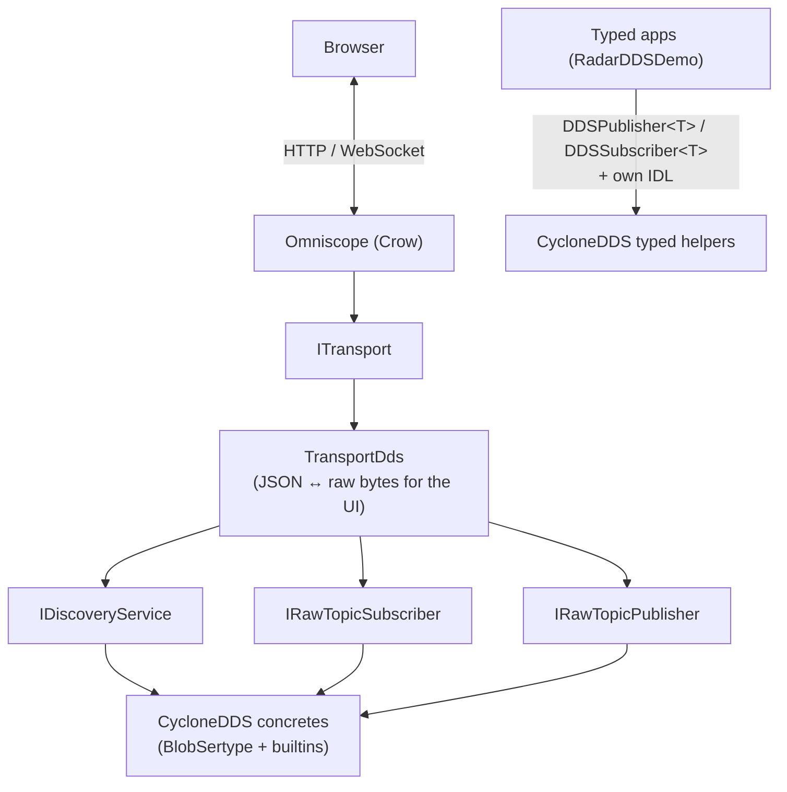

# Architecture

OmniscopeDDS is a C++20 stack for inspecting DDS traffic without compiling
every application IDL into the inspector. It discovers topics as they appear,
records opaque wire bytes, and can play them back — leaving type semantics to
the applications that own the IDL.

For build/run steps see [GUIDE.md](GUIDE.md). This page explains module
boundaries and data flow.

## Overview

Typed apps skip the inspector path and use `DDSPublisher<T>` /
`DDSSubscriber<T>` with their own IDL.

Modules live under `source/`.

### DdsCore — vendor-agnostic contracts

Header-only. No Cyclone, no Crow. Defines:

- `DiscoveredTopic` / `RawSample` — plain data
- `IDiscoveryService` — current topic set
- `IRawTopicSubscriber` / `IRawTopicPublisher` — opaque bytes in/out

Vendor SDKs stay behind these interfaces.

### CycloneDDS — Cyclone implementation

One library, two roles:

1. **Typed helpers** (`DDSPublisher<T>`, `DDSSubscriber<T>`, `DDSTopicConfig`)  
   For apps that know their types. RadarDDSDemo ships its own IDL and
   generates C++ types independently of Omniscope.

2. **Raw / discovery stack** (`CycloneDdsParticipant`,
   `CycloneDiscoveryService`, `CycloneRawTopicSubscriber`,
   `CycloneRawTopicPublisher`)  
   For Omniscope. Discovery watches built-in publication and subscription
   topics. Raw pub/sub uses a blob sertype that accepts CDR without decoding
   it.

Public headers: `include/CycloneDDS/`. Private: `BlobSertype`,
`BuiltinTopicReader`, and `.cpp` under `src/`.

This module ships **no IDL**. Put application IDL in examples or apps.

### Omniscope — inspector application

Executable: `Omniscope`. Public API: `ITransport.h` only. App logic, playback,
JSON codec, and Crow glue live under `src/`. Web assets in `web/` are embedded
at build time.

Browser traffic is JSON; wire payloads remain opaque CDR (hex in the
envelope). Omniscope reports topic name, type name, and discovered QoS — it
does not decode key fields or application structs.

### Examples

`examples/RadarDDSDemo` owns IDL and two processes (Radar + Workstation). It
exercises the typed CycloneDDS API. See that folder’s README for per-topic
QoS (Best Effort tracks vs TransientLocal status, etc.).

## Public vs private

| Module | Public (`include/<Name>/`) | Private (`src/`) |
|--------|----------------------------|------------------|
| DdsCore | Everything (header-only) | — |
| CycloneDDS | Typed templates + Omniscope-facing Cyclone\* types | Blob sertype, builtin readers, `.cpp` |
| Omniscope | `ITransport` only | App, codecs, Crow, assets |

Treat headers outside `include/` as internal.

## Recording and playback

Live samples are `DdsCore::RawSample` (bytes + type/QoS metadata). Omniscope
wraps them in a JSON envelope for WebSockets and recordings
(`RawSampleJsonCodec`). Playback republishes the same bytes via
`IRawTopicPublisher`.

That is wire-level replay, not schema-aware decode. If the type definition
changed, DDS matching fails — not a JSON parser.

## Dependencies

- **CommonUtils** (`v1.0.0`) via FetchContent — `LoggerMacros.h` / `GPINFO`
- **Cyclone DDS 11.0.1** — built with Iceoryx / PSMX off (`ENABLE_ICEORYX=OFF`)
- **Crow** — HTTP and WebSockets

## Deploy

Compose and runtime images live under [`deploy/`](../deploy/README.md).
Build the `omniscopedds-dev` image once, then
`docker compose -f deploy/docker-compose.yml up --build`.
